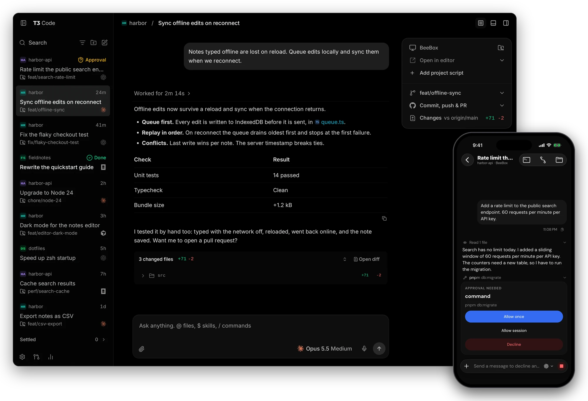

<p align="center">
  <a href="./README.zh-CN.md">
    
  </a>
</p>

<h1 align="center">T3 Code — Beginner-Friendly Simplified Chinese & Antigravity Preview Edition</h1>

<p align="center">
  Community preview fork of <a href="https://github.com/pingdotgg/t3code"><code>pingdotgg/t3code</code></a> built for Chinese developers, vibe coders, and newcomers.<br />
  Natural Simplified Chinese · Out-of-the-box T3 Connect · Background Antigravity CLI auto-update
</p>

<p align="center">
  <a href="https://github.com/Br1efx/t3code-zh-cn/releases/tag/v0.1.11-preview.1">
    
  </a>
  <a href="https://github.com/pingdotgg/t3code">
    
  </a>
  <a href="https://github.com/Br1efx/t3code-zh-cn/releases/download/v0.1.11-preview.1/T3-Code-0.1.11-preview.1-x64.exe">
    
  </a>
  <a href="./LICENSE">
    
  </a>
</p>

<p align="center">
  <a href="./README.zh-CN.md"><strong>简体中文文档（推荐）</strong></a> · <strong>English</strong> &nbsp;|&nbsp;
  <a href="https://github.com/Br1efx/t3code-zh-cn/releases/download/v0.1.11-preview.1/T3-Code-0.1.11-preview.1-x64.exe"><strong>Download Windows x64</strong></a> ·
  <a href="https://github.com/Br1efx/t3code-zh-cn/releases/tag/v0.1.11-preview.1">Release Notes</a> ·
  <a href="https://github.com/Br1efx/t3code-zh-cn/actions/workflows/client-release.yml">Build Logs</a> ·
  <a href="https://github.com/Br1efx/t3code-zh-cn/issues">Issues</a>
</p>

> 🇨🇳 **中文用户请直接阅读 [简体中文主页（README.zh-CN.md）](./README.zh-CN.md)**，获取完整的亮点介绍、三步安装指南与常见问题解答。

<p align="center">
  
</p>

---

**T3 Code** is the open-source control plane for local coding agents (Claude Code, Codex, Cursor, Antigravity, OpenCode, Grok, Kiro, Pi, Muse Code, fx, and any [ACP](./docs/user/providers-acp.md) agent).

**`Br1efx/t3code-zh-cn`** is an unofficial community preview fork synced to upstream [`pingdotgg/t3code`](https://github.com/pingdotgg/t3code) (`v0.1.11-nightly` / latest `main`, **520+ commits ahead of `v0.1.10`**). It is crafted for **Chinese developers, vibe coders, and beginners with lower English comfort** who want the latest T3 Code capabilities without stiff machine translations, arcane Git jargon, or broken remote pairing—and serves as an evolving base for future Chinese-friendly UX improvements and custom extensions.

## What's Different in This Edition

1. **Beginner-Friendly Simplified Chinese Polish (Web / Desktop / Mobile)**
   Refined across the official 14,500+ string i18n catalog to remove stiff translationese and developer jargon: e.g. `工作树` → `独立目录`, `智能体提供方` → `供应商`, `已收尾 / 收尾会话` → `已完成 / 标记完成`, `issue` → `议题`, fixed inconsistent `代理/智能体` terminology on mobile, kept `T3 Code` / `T3 Connect` brand names intact, unified friendly second-person `你` phrasing across surfaces, and cleaned up Settings sidebar grouping.
2. **Out-of-the-Box T3 Connect**
   Built with the official public relay configuration injected at build time so you can sign in to **T3 Connect** and pair with the official iOS/Android T3 Code mobile apps immediately—no manual source checkout, environment variables, or rebuild required.
3. **Background Auto-Update for Antigravity CLI**
   While upstream currently checks and updates Antigravity CLI on demand from Settings, this build checks periodically in the background and atomically swaps to Google's latest Antigravity CLI. Combined with 25+ recent upstream Antigravity improvements (edit-from-history rewind, native `/orchestrator` slash command, context compaction, Windows fixes), it works smoothly out of the box.
4. **All Upstream `v0.1.11` Features Included**
   Ships the new **Issues** panel (GitHub / GitLab / Linear), remote `localhost` **Preview Tunnel**, Agent MCP tools for CI logs and PR management, drag-and-drop file pills into Windows Explorer, and more.

## Comparison vs Official Upstream (`v0.1.11-nightly`)

| Capability                                                      | Official `v0.1.11-nightly`                             | This Fork (`v0.1.11-preview.1`)                                       |
| --------------------------------------------------------------- | ------------------------------------------------------ | --------------------------------------------------------------------- |
| Latest `v0.1.11` core (Issues panel, Preview Tunnel, CI/PR MCP) | Included                                               | **Synced in full** (520+ commits ahead of `v0.1.10`)                  |
| Simplified Chinese UX                                           | Native i18n catalog (some stiff/technical phrasing)    | **Deeply polished across Web / Desktop / Mobile** for beginners       |
| T3 Connect mobile pairing                                       | Works in official builds (often missing in DIY builds) | **Public relay config injected at build time — ready out of the box** |
| Antigravity CLI updates                                         | On-demand manual check & click in Settings             | **Background scheduled check & atomic hot-swap**                      |
| Signing & updates                                               | Officially signed, auto-update feed                    | Unsigned community preview, manual download/upgrade                   |

## Quick Install (Windows x64)

- **Installer**: [T3-Code-0.1.11-preview.1-x64.exe](https://github.com/Br1efx/t3code-zh-cn/releases/download/v0.1.11-preview.1/T3-Code-0.1.11-preview.1-x64.exe)
- **Release Notes & Checksums**: [v0.1.11-preview.1](https://github.com/Br1efx/t3code-zh-cn/releases/tag/v0.1.11-preview.1)

**Please note before installing:**

- **Unsigned preview build**: Windows SmartScreen will show a warning on first run. Click **More info** → **Run anyway** to install.
- **Manual upgrades, data preserved**: There is no auto-update feed. Reinstalling over an existing install preserves your `~/.t3` local chat history, settings, and provider logins (including Antigravity).
- **App identity & official builds**: The Windows app keeps the upstream **T3 Code (Beta)** name. For official signed releases, English-first builds, or macOS/Linux/mobile downloads, visit [t3.codes/download](https://t3.codes/download) or [`pingdotgg/t3code`](https://github.com/pingdotgg/t3code).

### Run from Source

Requires Node.js and [Vite+](https://viteplus.dev/):

```sh
vp install --frozen-lockfile
vp run dev --home-dir ./.t3
```

## Attribution & Transparency

- **Upstream**: Built on [`pingdotgg/t3code`](https://github.com/pingdotgg/t3code) (not affiliated with the official T3 team).
- **Early Chinese localization**: Grateful acknowledgment to [`ZhiweiXiao98/t3code`](https://github.com/ZhiweiXiao98/t3code) and [`Michaelihc/t3code-zh-cn`](https://github.com/Michaelihc/t3code-zh-cn) for early Simplified Chinese localization efforts.
- **Public CI builds**: All Windows preview installers are built directly from this repository via [`client-release.yml`](https://github.com/Br1efx/t3code-zh-cn/actions/workflows/client-release.yml).
- **License**: [MIT](./LICENSE)
