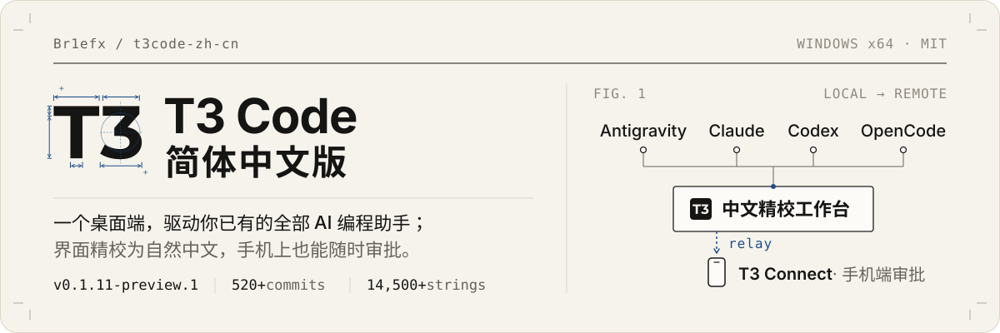
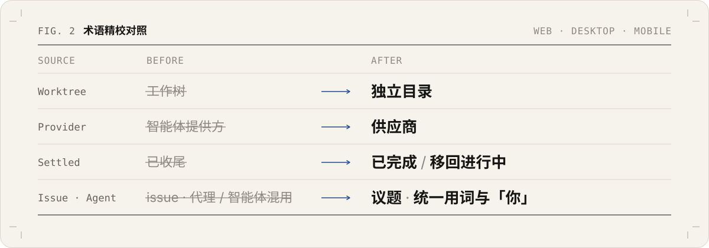
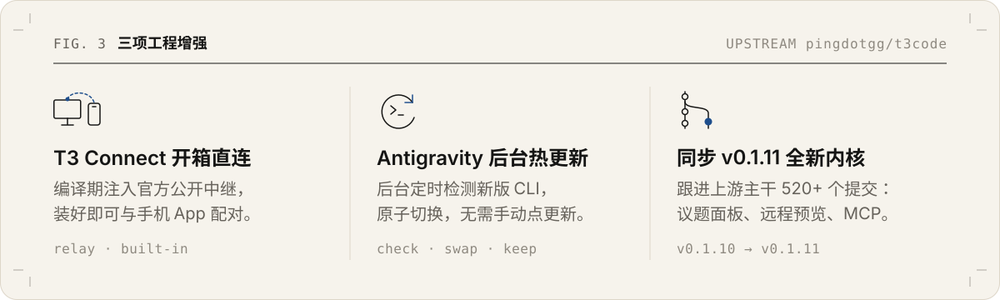

<p align="center">
  
</p>

<p align="center">
  <a href="https://github.com/Br1efx/t3code-zh-cn/releases/download/v0.1.11-preview.1/T3-Code-0.1.11-preview.1-x64.exe"><strong>下载 Windows x64 安装包（v0.1.11-preview.1）</strong></a> ·
  <a href="https://github.com/Br1efx/t3code-zh-cn/releases/tag/v0.1.11-preview.1">发布说明</a> ·
  <a href="https://github.com/Br1efx/t3code-zh-cn/actions/workflows/client-release.yml">公开构建记录</a> ·
  <a href="https://github.com/Br1efx/t3code-zh-cn/issues">问题反馈</a> ·
  <a href="./LICENSE">MIT 协议</a>
</p>

<p align="center">
  <strong>简体中文</strong> ·
  <a href="./README.en.md">English</a> ·
  <a href="./README.ja.md">日本語</a> ·
  <a href="./README.ko.md">한국어</a> ·
  <a href="./README.es.md">Español</a> ·
  <a href="./README.ru.md">Русский</a>
</p>

<p align="center">
  
</p>

**T3 Code** 是开源的多 Agent 编程控制面板：用一个本地桌面端，同时驱动你已有的 Antigravity、Claude Code、Codex、OpenCode、Cursor、Grok、Kiro 等工具，并在电脑、网页和手机之间实时同步进度。

本仓库（`Br1efx/t3code-zh-cn`）基于上游 [`pingdotgg/t3code`](https://github.com/pingdotgg/t3code) 最新主干（同步至 `v0.1.11-nightly`，领先 `v0.1.10` **520+ 个提交**），专为**希望无门槛上手最新版 T3 Code 的中文开发者、Vibe Coder 与技术新手**打造。

---

## 全端精校简体中文

<p align="center">
  
</p>

在官方 14,500+ 词条多语言底座之上，逐项润色 Web / Desktop / Mobile 全端文案：`工作树（Worktree）` 改为**独立目录**、`智能体提供方` 改为**供应商**、`已收尾` 改为**已完成 / 移回进行中**，`issue` 统一为**议题**，移动端混用的「代理 / 智能体」与敬语也统一为全端一致用词和亲切「你」称呼。`T3 Code` / `T3 Connect` 保留品牌原名，设置页侧栏的分组线也一并优化。

---

## 核心增强与版本对比

<p align="center">
  
</p>

| 对比维度                                                                    | 官方 `v0.1.11-nightly`                 | 本版 `v0.1.11-preview.1`                                |
| :-------------------------------------------------------------------------- | :------------------------------------- | :------------------------------------------------------ |
| **最新 `v0.1.11` 内核**<br>议题面板 / 远程预览穿透 / CI & PR MCP / 文件拖拽 | 支持                                   | **同步完整支持**（领先 `v0.1.10` 520+ 提交）            |
| **简体中文体验**                                                            | 原生多语言底座（部分术语偏生硬）       | **Web / Desktop / Mobile 全端精校**，去翻译腔与黑话     |
| **T3 Connect 手机远程配对**                                                 | 官方打包可用（社区自编译常缺中继配置） | **编译期注入官方公开中继，安装即用**                    |
| **Antigravity CLI 更新**                                                    | 设置页按需检查、手动点击更新           | **后台定时检测并原子热切换至最新版**（含 25+ 上游改进） |
| **代码签名与更新方式**                                                      | 官方代码签名、支持自动更新源           | **未签名社区预览版**、通过 Releases 手动覆盖升级        |

---

## 快速安装（3 步上手）

1. **下载安装包**
   直接下载 Windows x64 安装包：**[T3-Code-0.1.11-preview.1-x64.exe](https://github.com/Br1efx/t3code-zh-cn/releases/download/v0.1.11-preview.1/T3-Code-0.1.11-preview.1-x64.exe)**（或前往 [v0.1.11-preview.1 发布页](https://github.com/Br1efx/t3code-zh-cn/releases/tag/v0.1.11-preview.1) 核对校验值）。

2. **放行 Windows SmartScreen 提示**
   由于本版为**未签名的开源社区预览构建**，首次运行时 Windows Defender SmartScreen 会弹出保护提示。点击 **「更多信息（More info）」→「仍要运行（Run anyway）」** 即可继续安装。

3. **启动并连接你的 AI 工具**
   应用名称沿用上游的 **T3 Code (Beta)**。在中文系统下自动显示简体中文，登录已有供应商（Antigravity、Claude Code、Codex、OpenCode、Cursor 等）即可开用；需要手机远程控制时，打开 **设置 → 共享与访问权限** 登录 **T3 Connect** 与官方 App 配对即可。

> [!NOTE]
> **透明提示与边界说明**
>
> - 本版为**非官方社区预览版**，不包含商业代码签名，也不接入自动更新源；后续新版本通过 GitHub Releases 手动下载覆盖升级。
> - 如需官方正式签名版、英文原版或 macOS / Linux 安装包，请前往上游 [t3.codes](https://t3.codes/download) 或 [`pingdotgg/t3code`](https://github.com/pingdotgg/t3code)。

<details>
<summary><strong>开发者：从源码本地运行</strong></summary>

需要 Node.js 与 [Vite+](https://viteplus.dev/)：

```sh
vp install --frozen-lockfile
vp run dev --home-dir ./.t3
```

</details>

---

## 常见问题（FAQ）

<details>
<summary><strong>1. 覆盖安装会丢失我的聊天记录、设置或登录态（如 Antigravity）吗？</strong></summary>

**不会。** 本版沿用 T3 Code 的标准数据目录 `~/.t3`，直接覆盖安装或从旧版升级时，本地对话记录、项目列表、个人设置以及各供应商登录态（Antigravity、Claude Code、Codex 等）均会完整保留。

如果希望与官方版隔离服务端数据，可在启动前关闭其他 T3 桌面端，并在 PowerShell 中用 `T3CODE_HOME` 指定独立目录：

```powershell
$env:T3CODE_HOME = "$env:USERPROFILE\.t3-zh-cn"
& "C:\path\to\T3 Code (Beta).exe"
```

</details>

<details>
<summary><strong>2. 为什么 Windows 会提示「已保护你的电脑」（SmartScreen）？安全吗？</strong></summary>

Windows SmartScreen 会对所有**未购买商业代码签名证书**的新发布开源可执行文件弹出此警告，不代表程序包含恶意代码。本仓库的所有安装包均由 GitHub Actions 公开工作流自动构建，可随时查阅源码差异与 [构建日志](https://github.com/Br1efx/t3code-zh-cn/actions/workflows/client-release.yml)，并在发布页核对安装包校验值。

</details>

<details>
<summary><strong>3. 怎么把电脑上的 T3 Code 连接到手机端？</strong></summary>

1. 在手机上安装官方 T3 Code App（[App Store](https://apps.apple.com/us/app/t3-code-remote-claude-more/id6787819824) / [Google Play](https://play.google.com/store/apps/details?id=com.t3tools.t3code)）。
2. 在本版桌面端打开 **设置 → 共享与访问权限**，登录 **T3 Connect** 账号。
3. 使用手机 App 登录同一账号或扫描配对二维码，即可实时查看进度、审批命令并继续对话。

</details>

<details>
<summary><strong>4. 如何切换界面语言？</strong></summary>

在桌面端或网页端打开 **设置 → 常规 → 语言**，即可在 `简体中文`、`English` 与 `跟随系统` 之间自由切换。

</details>

---

## 致谢与源码透明验证

- **上游项目**：感谢 [`pingdotgg/t3code`](https://github.com/pingdotgg/t3code) 团队开源出色的本地 Agent 控制面板。本项目与官方团队无隶属关系。
- **早期中文社区贡献**：致谢 [`ZhiweiXiao98/t3code`](https://github.com/ZhiweiXiao98/t3code)（肖志伟）与 [`Michaelihc/t3code-zh-cn`](https://github.com/Michaelihc/t3code-zh-cn) 在早期简体中文化上的先行探索。
- **构建透明**：所有 Windows 预发布安装包均通过仓库公开工作流 [`client-release.yml`](https://github.com/Br1efx/t3code-zh-cn/actions/workflows/client-release.yml) 由开源代码直接构建，欢迎审查每一行提交。
- **开源协议**：沿用上游 [MIT License](./LICENSE)。
